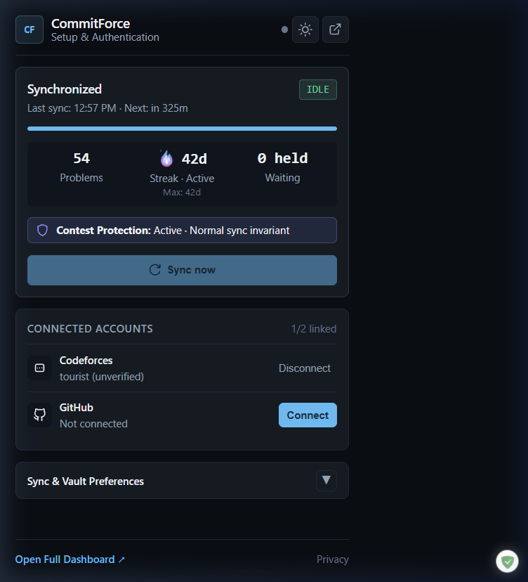
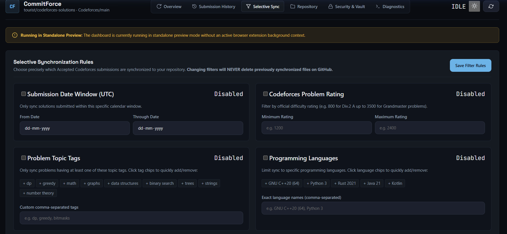
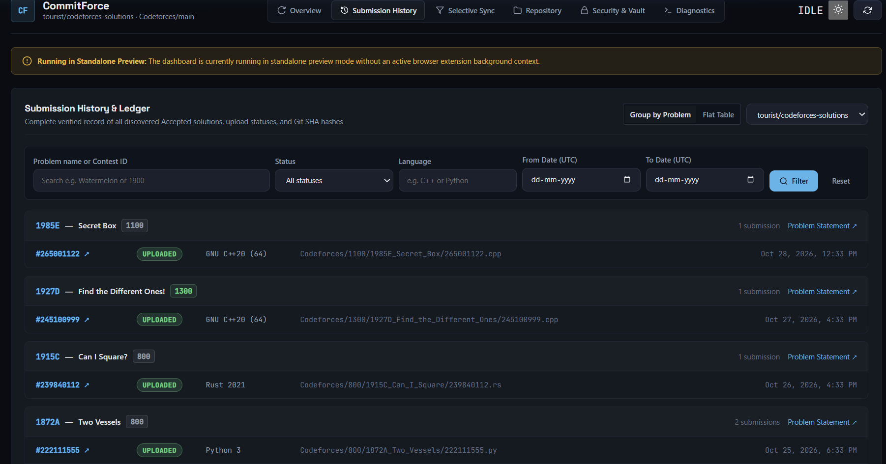

# Codeforces → GitHub Sync

Import your Accepted Codeforces solutions into a GitHub repository, then keep them in sync automatically.

[Download the latest release](https://github.com/F0RREALTHO/codeforces-github-sync/releases/latest) · [Privacy policy](https://f0rrealtho.github.io/codeforces-github-sync/public/privacy.html) · [Support](mailto:kartikeyaaryam03@gmail.com)

## Screenshots

**Sync overview**



**Dashboard and selective sync filters**



**Submission history**



## Install and start syncing

1. Download the ZIP from [Releases](https://github.com/F0RREALTHO/codeforces-github-sync/releases/latest) and extract it.
2. Open `chrome://extensions` in Chrome or `brave://extensions` in Brave. Turn on **Developer mode**, choose **Load unpacked**, and select the extracted folder containing `manifest.json`.
3. Open the extension and create a vault passphrase.
4. Connect Codeforces using your handle and API key/secret from [Codeforces API settings](https://codeforces.com/settings/api).
5. Choose **Install & connect** for GitHub, approve the app, and select the repository where your solutions should go.
6. Click **Start historical import**.

That’s it. The extension checks for newer Accepted submissions automatically. Keep the extracted folder where it is. To update, download and extract the newer ZIP over that folder, then click **Reload** on the browser’s extensions page. Updates are manual. Do not remove the extension to update; that can erase its local vault and history.

### Browser availability

- **Chrome and Brave:** use the GitHub Release ZIP and the unpacked-install steps above.
- **Microsoft Edge:** the Edge Add-ons submission is in review. The Edge store package has its own store-assigned extension identity; use the store listing once it is approved and published.
- **Firefox:** the Firefox AMO submission is awaiting review. Install from the AMO listing once it is approved and published.

Edge and Firefox use browser-specific builds. Each browser profile keeps its own vault and sync history; history is not automatically shared between browsers. See the [browser store submission guide](docs/STORE_SUBMISSION.md) for maintainer build and submission details.

## What it does

- Saves solutions under `Codeforces/<contest>/<problem>_<name>.<extension>`.
- Shows sync history and lets you filter which submissions sync. Filters are off by default.
- Protects unrelated or changed GitHub files: when a new browser profile imports history, it recognizes an existing solution only if its full Git blob SHA matches the exact generated Codeforces solution. It leaves that file untouched and records the verified ownership locally; files that merely occupy the same path or have different content still need resolution.
- Encrypts credentials in a local vault. History and ownership records are stored in each browser profile, not automatically shared between browsers or devices. To populate history in another browser, connect the same accounts and repository there, then run **Re-import history**; exact matching solutions are recognized without duplicate GitHub writes. No GitHub Personal Access Token is used.

Codeforces may not return source for every submission. If it does not, that submission is reported and older code is not substituted. Because Codeforces uses offset-based history pages, run **Re-import history** after submissions have settled if you need to reconcile a large import.

## Troubleshooting

- **“GitHub sign-in is not configured in this build.”** Use the production ZIP from Releases, not a development or test build. The published v0.2.0 ZIP includes production sign-in settings. If you still see this in that release, contact support with your extension version and browser. Do not edit configuration files or send secrets.
- **“Could not reach the sign-in service.”** Check your internet connection and retry.
- **A destination collision is reported.** The existing file differs from the exact solution being imported or its ownership cannot be verified. Review the file in GitHub before moving/renaming it and retrying; the extension will not overwrite changed or unrelated content.
- **The vault is locked after restarting the browser.** Unlock it with your vault passphrase. If you forget it, reset the vault and reconnect; the encrypted credentials cannot be recovered without the passphrase.
- **An import stopped.** Reopen the extension, unlock the vault, and let it resume from its saved checkpoint.

Questions? Email [kartikeyaaryam03@gmail.com](mailto:kartikeyaaryam03@gmail.com). Never include passwords, API secrets, OAuth codes, tokens, or private solution source in a support request.

<details>
<summary>For contributors: build and test</summary>

Requirements: Node.js 22+ and npm.

```sh
npm ci
npm test
npm run build
npm run build:test
```

The production build is in `dist/`; the isolated test build is in `dist-test/`. These folders are for unpacked local testing. Public production build settings belong in ignored `.env.local`; test settings belong in ignored `.env.test.local`. Never put a GitHub App Client Secret in a `VITE_*` variable. For local Worker secrets, use ignored `backend/.dev.vars`.

To check the Worker:

```sh
cd backend
npm ci
npm run check
```

On Windows, run `scripts/package-release.ps1` after `npm run build` to create a clean production ZIP. Review its file list and SHA-256 before attaching it to a GitHub Release.

Architecture and maintainer guides: [production configuration](docs/PRODUCTION_CONFIGURATION.md), [extension identity](docs/EXTENSION_IDENTITY.md), and [manual integration checklist](docs/manual-integration-v0.2.md).

</details>
