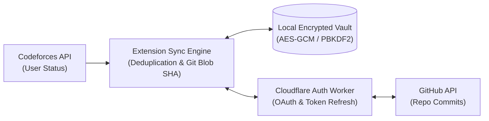

<p align="center">
  
</p>

<h1 align="center">Codeforces → GitHub Sync</h1>

<p align="center">
  <strong>Automatically import and synchronize your Accepted Codeforces solutions to your personal GitHub repository.</strong><br>
  Built with privacy-first client-side vault encryption, Git blob SHA conflict protection, and cross-browser support.
</p>

<p align="center">
  <a href="https://github.com/F0RREALTHO/codeforces-github-sync/releases/latest"></a>
  <a href="https://github.com/F0RREALTHO/codeforces-github-sync/actions/workflows/ci.yml"></a>
  <a href="https://github.com/F0RREALTHO/codeforces-github-sync/actions"></a>
  
  
</p>

<p align="center">
  <a href="#-quick-start">Quick Start</a> •
  <a href="#-browser-availability">Browser Status</a> •
  <a href="#-key-features">Key Features</a> •
  <a href="#-architecture">Architecture</a> •
  <a href="#-security--privacy">Security</a> •
  <a href="#-troubleshooting">FAQ</a> •
  <a href="https://f0rrealtho.github.io/codeforces-github-sync/public/privacy.html">Privacy Policy</a>
</p>

---

## 📸 Overview

<table align="center" width="100%">
  <tr>
    <td width="33%" align="center">
      <strong>Popup Sync Overview</strong><br><br>
      
    </td>
    <td width="33%" align="center">
      <strong>Dashboard & Custom Filters</strong><br><br>
      
    </td>
    <td width="33%" align="center">
      <strong>Verified Submission History</strong><br><br>
      
    </td>
  </tr>
</table>

---

## 🌐 Browser Availability

| Browser | Status | Distribution |
| :--- | :--- | :--- |
| **Google Chrome** | 🟢 Manual (ZIP) | [Download Latest Release ZIP](https://github.com/F0RREALTHO/codeforces-github-sync/releases/latest) *(Chrome Web Store coming Dec 2026)* |
| **Brave Browser** | 🟢 Supported | Load unpacked release via `brave://extensions` |
| **Mozilla Firefox** | 🟡 In Review | Firefox AMO listing awaiting final review |
| **Microsoft Edge** | 🟡 In Review | Microsoft Edge Add-ons listing in review |

> [!NOTE]
> Edge and Firefox use browser-specific builds with isolated local vaults. Each browser profile maintains its own encrypted vault and sync history.

---

## ✨ Key Features

* ⚡ **Historical Backfill & Live Polling:** Seamlessly imports your past Accepted submissions while continuously polling for newly solved problems.
* 🛡️ **Zero Secret Leakage:** No broad GitHub Personal Access Tokens (PATs) required. All tokens are encrypted using **PBKDF2 + AES-GCM** inside an isolated client-side vault.
* 🔍 **Git-Blob Conflict Protection:** Uses Git SHA-1 hashing to verify exact code matching before writing. It never overwrites your existing custom files or creates duplicate commits.
* 📁 **Organized Directory Structure:** Automatically sorts code into clean, intuitive folders:
  ```
  Codeforces/
  └── 1900/
      └── A_Cover_in_Water.cpp
  ```
* 🎯 **Selective Sync Filtering:** Filter which solutions sync based on tags, rating limits, or contest types directly from the dashboard.
* 🔄 **Resilient Sync Engine:** Handles Codeforces pagination offsets, GitHub rate-limiting with exponential backoff & jitter, and network reconnections gracefully.

---

## 🚀 Quick Start

1. **Download the Extension:**
   Grab the production build from [Releases](https://github.com/F0RREALTHO/codeforces-github-sync/releases/latest) and extract the `.zip` file.
2. **Install in Your Browser:**
   - Go to `chrome://extensions` (or `brave://extensions`).
   - Enable **Developer mode** (top-right toggle).
   - Click **Load unpacked** and select the folder containing `manifest.json`.
3. **Initialize Your Vault:**
   Open the extension popup and create a master vault passphrase.
4. **Connect Codeforces:**
   Enter your handle and API credentials from [Codeforces API settings](https://codeforces.com/settings/api).
5. **Connect GitHub:**
   Click **Install & connect**, authorize the app, and choose the target repository.
6. **Start Historical Import:**
   Hit **Start historical import** to archive your past solutions. Going forward, the extension monitors and syncs new AC submissions automatically!

> [!TIP]
> Keep the extracted folder in a permanent location. To update to a newer release, simply overwrite the folder files and click **Reload** in `chrome://extensions`—never uninstall the extension to update, as that clears your local vault.

---

## 🏗️ Architecture



---

## 🔒 Security & Privacy

* **Local Master Key:** Your Codeforces credentials and OAuth tokens are encrypted at rest using `AES-GCM-256` with keys derived via `PBKDF2-SHA256` (100,000 iterations).
* **OAuth Security:** Extension authentication uses PKCE (Proof Key for Code Exchange) and an isolated Cloudflare Worker proxy so that no client secrets are ever bundled into extension source code.
* **Granular Scope:** Only requires minimal permissions necessary for reading Codeforces submissions and writing solutions to your chosen repository.

---

## ❓ Troubleshooting & FAQ

<details>
<summary><strong>"GitHub sign-in is not configured in this build."</strong></summary><br>
Make sure you are using the official release ZIP from the Releases tab, not an unpacked development build. Production releases are pre-configured with production OAuth client credentials.
</details>

<details>
<summary><strong>"A destination collision is reported."</strong></summary><br>
A file already exists at the target path in your GitHub repository, but its Git SHA differs from the solution being imported. Review or rename the file on GitHub before re-attempting import to prevent accidental overwrites.
</details>

<details>
<summary><strong>"The vault is locked after restarting my browser."</strong></summary><br>
Enter your vault passphrase to unlock it. If you forget your passphrase, you can reset the vault and reconnect your accounts (the encrypted credentials cannot be recovered without the passphrase).
</details>

---

## 🛠️ For Developers & Contributors

<details>
<summary><strong>Building and running locally</strong></summary><br>

### Prerequisites
* Node.js 22+
* npm

```bash
# Clone the repository
git clone https://github.com/F0RREALTHO/codeforces-github-sync.git
cd codeforces-github-sync

# Install dependencies
npm ci

# Run test suites (103 unit & integration tests)
npm test

# Build production bundles
npm run build
npm run build:firefox
npm run build:edge
```

The compiled outputs will be generated in `dist/`, `dist-firefox/`, and `dist-edge/`.

For complete contributor and submission guidelines, see:
* [Cross Browser Release Guide](docs/CROSS_BROWSER_RELEASE.md)
* [Store Submission Guide](docs/STORE_SUBMISSION.md)
* [Production Configuration](docs/PRODUCTION_CONFIGURATION.md)

</details>

---

<p align="center">
  Crafted with ❤️ for competitive programmers. If you find this project helpful, give it a ⭐ on GitHub!
</p>
