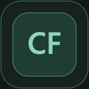
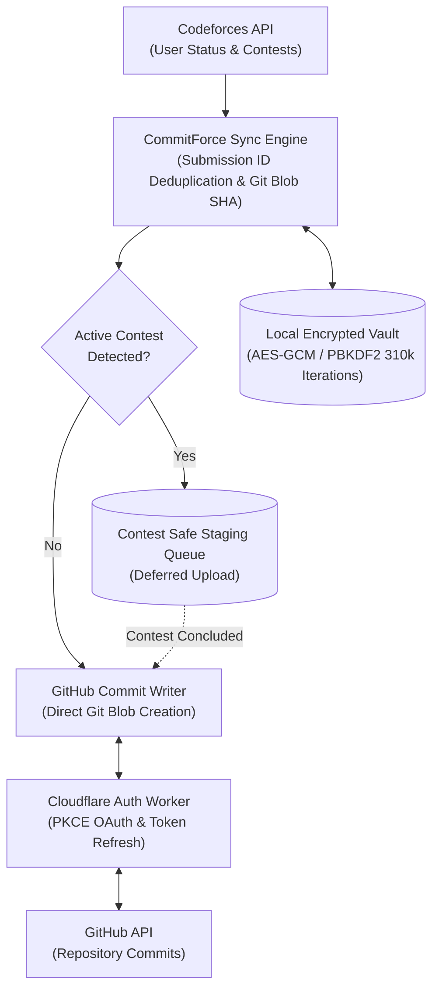

<p align="center">
  
</p>

<h1 align="center">CommitForce</h1>

<p align="center">
  <strong>Automated, Contest-Safe Codeforces → GitHub Solution Sync</strong><br>
  Built with privacy-first client-side vault encryption, dynamic streak fire tracking, multi-solution preservation, and zero secret leakage.
</p>

<p align="center">
  <a href="https://github.com/F0RREALTHO/codeforces-github-sync/releases/latest"></a>
  <a href="https://github.com/F0RREALTHO/codeforces-github-sync/actions/workflows/ci.yml"></a>
  <a href="https://github.com/F0RREALTHO/codeforces-github-sync/actions"></a>
  
  
  
</p>

<p align="center">
  <a href="#-quick-start">Quick Start</a> •
  <a href="#-visual-overview">Visual Overview</a> •
  <a href="#-how-commitforce-fetches-source-code-vs-other-extensions">How Code Is Fetched</a> •
  <a href="#-key-features">Key Features</a> •
  <a href="#-directory-structure">Repository Layout</a> •
  <a href="#-architecture">Architecture</a> •
  <a href="#-security--privacy">Security</a> •
  <a href="#-troubleshooting--faq">FAQ</a> •
  <a href="https://f0rrealtho.github.io/codeforces-github-sync/public/privacy.html">Privacy Policy</a>
</p>

---

## 📸 Visual Overview

<table align="center" width="100%">
  <tr>
    <td width="30%" align="center" valign="top">
      <strong>Extension Popup & Flame Tier</strong><br>
      <sub>Instant status, streak tier, and sync controls</sub><br><br>
      
    </td>
    <td width="70%" align="center" valign="top">
      <strong>Developer Dashboard & Streak Engine</strong><br>
      <sub>Personal streak records, activity heatmaps, and sync metrics</sub><br><br>
      
    </td>
  </tr>
  <tr>
    <td width="50%" align="center" valign="top">
      <strong>Problem-Grouped Submission Ledger</strong><br>
      <sub>Multi-solution preservation with dedicated submission tracking</sub><br><br>
      
    </td>
    <td width="50%" align="center" valign="top">
      <strong>Contest Safety & Selective Sync Filters</strong><br>
      <sub>Rating windows, tag filters, and contest protection rules</sub><br><br>
      
    </td>
  </tr>
</table>

---

## 🌐 Browser Availability

| Browser | Status | Distribution |
| :--- | :--- | :--- |
| **Google Chrome** | 🟢 Manual (ZIP) | [Download Latest Release ZIP](https://github.com/F0RREALTHO/codeforces-github-sync/releases/latest) *(Chrome Web Store coming Dec 2026)* |
| **Brave Browser** | 🟢 Supported | Load unpacked release via `brave://extensions` |
| **Mozilla Firefox** | 🟡 In Review | Firefox AMO listing awaiting final review |
| **Microsoft Edge** | 🟡 In Review | Microsoft Edge Add-ons listing in review |

> [!NOTE]
> Edge and Firefox use browser-specific distribution builds with isolated local vaults. Each browser profile maintains its own encrypted vault and sync ledger.

---

## ✨ Key Features

* 📁 **Preserve Every Accepted Solution:** Deduplication is strictly by **Codeforces Submission ID**, not problem identity. If you solve a problem with a brute-force approach and later write an optimized version or rewrite it in Python or Rust, **all Accepted solutions are preserved independently** under clean problem folders.
* 🔥 **Dynamic Streak Fire Engine:** Accurately calculates your Codeforces solving streaks directly from your full profile activity history:
  - Tracks **Current Streak**, **All-time Record**, **Best Last 365 Days**, and **Best Last 30 Days**.
  - Animated flame icon with 6 reactive intensity tiers (Dormant $\rightarrow$ Kindling $\rightarrow$ Ember $\rightarrow$ Blaze $\rightarrow$ Inferno $\rightarrow$ Legendary Plasma) that dynamically evolve as your streak climbs.
* 🛡️ **Contest-Aware Upload Protection:** Invariant sync guard that detects active or ongoing Codeforces contest participation. During live contests, newly submitted solutions are automatically held in an encrypted local staging queue and synced only after the round concludes—eliminating any risk of accidental code leaks or plagiarism disqualification.
* 🔒 **Zero Secret Leakage Vault:** No plain-text storage and no broad GitHub Personal Access Tokens (PATs). Credentials and OAuth tokens are secured using client-side **PBKDF2-SHA256 (310,000 iterations)** and **AES-GCM-256** encryption.
* 🔍 **Git-Blob Conflict Protection:** Uses Git SHA-1 hashing to verify exact code matching before writing. It never overwrites your existing custom files or creates duplicate commits.
* 🎯 **Granular Sync Filtering:** Filter which solutions sync based on tags, rating thresholds (e.g. 800 to 3500), language selection, or contest IDs directly from the dashboard.
* 🔄 **Resilient Sync Engine:** Handles Codeforces pagination offsets, GitHub API rate limits with exponential backoff & jitter, and network reconnections gracefully.

---

## ⚡ How CommitForce Fetches Source Code (vs. Other Extensions)

A major pain point with existing synchronization extensions is how they retrieve your solution source code:
* **[CodeforcesSync](https://github.com/mhdnazrul/CodeforcesSync)** relies on DOM content scripts and session cookies. As its documentation highlights (*"Uses your active Codeforces tab session to fetch source code without triggering Cloudflare blocks"*), **it requires an active Codeforces tab session** to scrape the page. If you close your tabs, work in an external IDE (like VS Code or CLion), or submit via tools like Competitive Companion, synchronization cannot proceed.
* **[cf-pusher](https://github.com/SarJ2004/cf-pusher)** creates pinned hidden browser tabs (`chrome.tabs.create`) to scrape submission HTML using DOM queries. **It cannot reliably push contest submissions** because Codeforces restricts submission page access during and immediately after contests (`ACCESS_DENIED_ERROR`). Furthermore, pushing code during live contests without a safety deferral guard risks plagiarism detection and contest disqualification.

### How CommitForce Solves Both:

CommitForce communicates directly with the **official Codeforces REST API** using **cryptographic request signing** (`user.status` with `includeSources=true`):

1. **Zero Open Tabs Required (100% Headless Background Sync):**
   - CommitForce operates entirely inside a lightweight background service worker via browser alarms—never creating hidden tabs or requiring active web pages.
   - Every request is cryptographically signed using your Codeforces API Key and Secret (`apiSig = hex(random + SHA512(random/user.status?<params>#secret))`).
   - Codeforces returns your source code directly in the official API payload (`sourceCode` / `sourceBase64`).
   - You can submit from any tool, close all browser windows, or practice offline—CommitForce synchronizes automatically in the background.
2. **Contest Submissions Supported + Contest Safety Invariant:**
   - Because your API requests are cryptographically authenticated, you have guaranteed access to your own contest submissions.
   - To protect your contest standing, CommitForce includes a strict **Contest-Aware Upload Protection** invariant: if an active contest is detected, submissions are held in an encrypted local staging queue and synchronized to GitHub only after the round concludes.
3. **Built-in Rate Limit Compliance:**
   - Enforces a strict 2.1-second inter-request queue to respect Codeforces' 1 request per 2 seconds rate limit, eliminating 429 errors and temporary IP bans.

### Direct Comparison Matrix

| Capability | **CommitForce** | [CodeforcesSync](https://github.com/mhdnazrul/CodeforcesSync) | [cf-pusher](https://github.com/SarJ2004/cf-pusher) |
| :--- | :---: | :---: | :---: |
| **Source Retrieval Method** | **Signed Official API** (`user.status?includeSources=true`) | DOM Scraping via Active Tab Session | Hidden Tab DOM Scraping (`chrome.tabs.create`) |
| **Requires Open Codeforces Tab?** | ❌ **No** (Headless background service worker) | ⚠️ **Yes** (*"Uses active Codeforces tab session"*) | ⚠️ Spawns hidden tabs |
| **Contest Submissions Supported?** | ✅ **Yes** (Via authenticated API signatures) | ⚠️ Only if submission page is loaded | ❌ **No** (`ACCESS_DENIED_ERROR` on contest code) |
| **Contest Anti-Plagiarism Safety** | ✅ **Yes** (Auto-defers during live contest windows) | ❌ No (Pushes immediately or breaks) | ❌ No |
| **Multi-Solution Preservation** | ✅ **Yes** (Preserves every AC by Submission ID) | ❌ Overwrites by Problem ID | ❌ Overwrites by Problem ID |
| **Credential Security** | 🔒 **Client-Side Vault (PBKDF2 310k + AES-GCM)** | ⚠️ Plain browser storage | ⚠️ Plain browser storage |
| **Rate Limit Protection** | ✅ **2.1s Inter-Call Queue + Jittered Backoff** | ⚠️ None / Tab-dependent | ⚠️ Basic |

---

## 📂 Directory Structure

CommitForce organizes your GitHub repository into clean, rating-stratified problem directories while keeping every Accepted attempt organized:

```
Codeforces/
├── 800/
│   ├── 1872A_Two_Vessels/
│   │   ├── 222111000.cpp        # Initial Accepted submission (GNU C++20)
│   │   └── 222111555.py         # Alternative / Optimized AC (Python 3)
│   └── 1915C_Can_I_Square/
│       └── 239840112.rs         # Accepted solution (Rust 2021)
└── 1100/
    └── 1985E_Secret_Box/
        └── 265001122.cpp        # Accepted solution (GNU C++20)
```

> Older single-file paths (e.g. `Codeforces/1900/A_Cover_in_Water.cpp`) remain fully supported with backward-compatible durable ownership tracking.

---

## 🚀 Quick Start

1. **Download CommitForce:**
   Grab the production build from [Releases](https://github.com/F0RREALTHO/codeforces-github-sync/releases/latest) and extract the `.zip` file.
2. **Install in Your Browser:**
   - Go to `chrome://extensions` (or `brave://extensions`).
   - Enable **Developer mode** (top-right toggle).
   - Click **Load unpacked** and select the folder containing `manifest.json`.
3. **Initialize Your Vault:**
   Open the CommitForce popup and create a master vault passphrase.
4. **Connect Codeforces:**
   Enter your handle and API credentials from [Codeforces API settings](https://codeforces.com/settings/api).
5. **Connect GitHub:**
   Click **Install & connect**, authorize the app, and choose your target repository.
6. **Start Historical Import:**
   Hit **Start historical import** to archive your past solutions. Going forward, CommitForce monitors and syncs new AC submissions automatically!

> [!TIP]
> Keep the extracted folder in a permanent location. To update to a newer release, simply overwrite the folder files and click **Reload** in `chrome://extensions`—never uninstall the extension to update, as that clears your local browser vault.

---

## 🏗️ Architecture



---

## 🔒 Security & Privacy

* **Local Master Key:** Your Codeforces credentials and OAuth tokens are encrypted at rest using `AES-GCM-256` with keys derived via `PBKDF2-SHA256` (310,000 iterations conforming to modern OWASP standards).
* **OAuth Security:** Extension authentication uses PKCE (Proof Key for Code Exchange) and an isolated Cloudflare Worker proxy so that no client secrets are ever bundled into extension source code.
* **Granular Scope:** Only requires minimal permissions necessary for reading Codeforces submissions and writing solutions to your chosen repository.

---

## ❓ Troubleshooting & FAQ

<details>
<summary><strong>"GitHub sign-in is not configured in this build."</strong></summary><br>
Make sure you are using the official release ZIP from the Releases tab, not an unpacked development build. Production releases are pre-configured with production OAuth client credentials.
</details>

<details>
<summary><strong>"A destination collision is reported."</strong></summary><br>
A file already exists at the target path in your GitHub repository, but its Git SHA differs from the solution being imported. Review or rename the file on GitHub before re-attempting import to prevent accidental overwrites.
</details>

<details>
<summary><strong>"How does CommitForce preserve multiple Accepted solutions for the same problem?"</strong></summary><br>
CommitForce uses the Codeforces Submission ID as the unique identity for each solution. Solutions are stored inside a dedicated problem folder (e.g. `Codeforces/800/1872A_Two_Vessels/<submissionId>.cpp`), so your early attempts, optimized approaches, and different language solutions coexist without replacing one another.
</details>

<details>
<summary><strong>"The vault is locked after restarting my browser."</strong></summary><br>
Enter your vault passphrase to unlock it. If you forget your passphrase, you can reset the vault and reconnect your accounts (the encrypted credentials cannot be recovered without the passphrase).
</details>

---

## 🛠️ For Developers & Contributors

<details>
<summary><strong>Building and running locally</strong></summary><br>

### Prerequisites
* Node.js 22+
* npm

```bash
# Clone the repository
git clone https://github.com/F0RREALTHO/codeforces-github-sync.git
cd codeforces-github-sync

# Install dependencies
npm ci

# Run complete test suites (138 unit & integration tests)
npm test

# Build production bundles
npm run build
npm run build:firefox
npm run build:edge
```

The compiled outputs will be generated in `dist/`, `dist-firefox/`, and `dist-edge/`.

For complete contributor and submission guidelines, see:
* [Cross Browser Release Guide](docs/CROSS_BROWSER_RELEASE.md)
* [Store Submission Guide](docs/STORE_SUBMISSION.md)
* [Production Configuration](docs/PRODUCTION_CONFIGURATION.md)

</details>

---

<p align="center">
  Crafted with ❤️ for competitive programmers. If you find CommitForce helpful, give it a ⭐ on GitHub!
</p>
